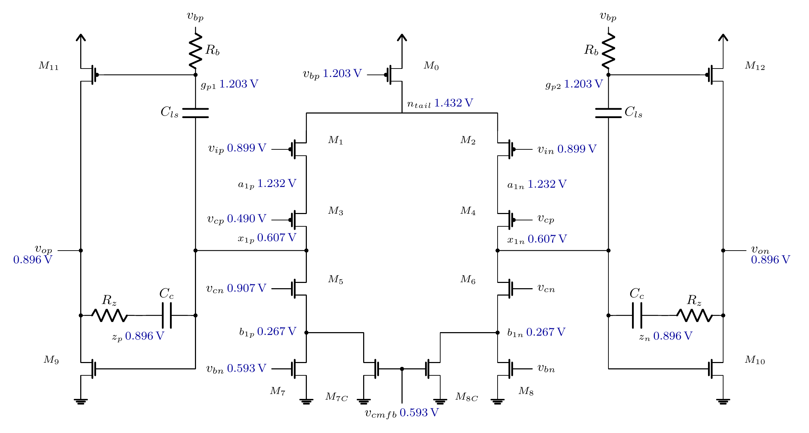
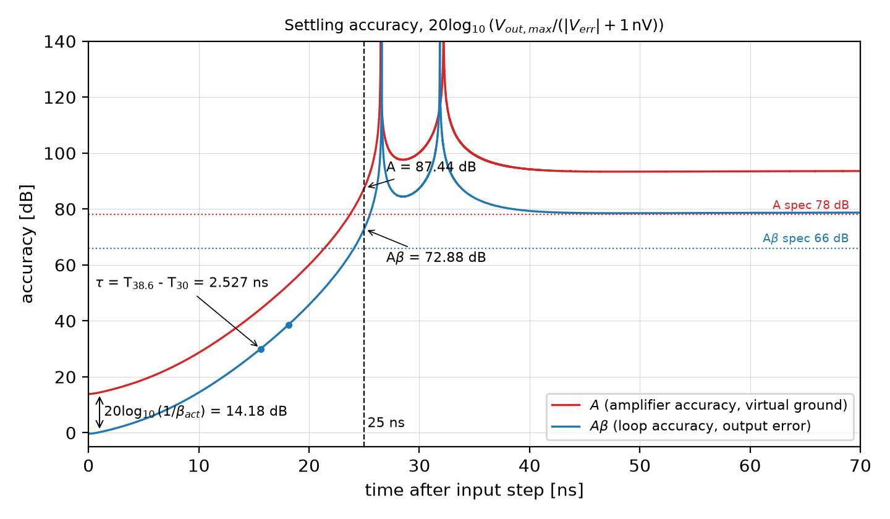
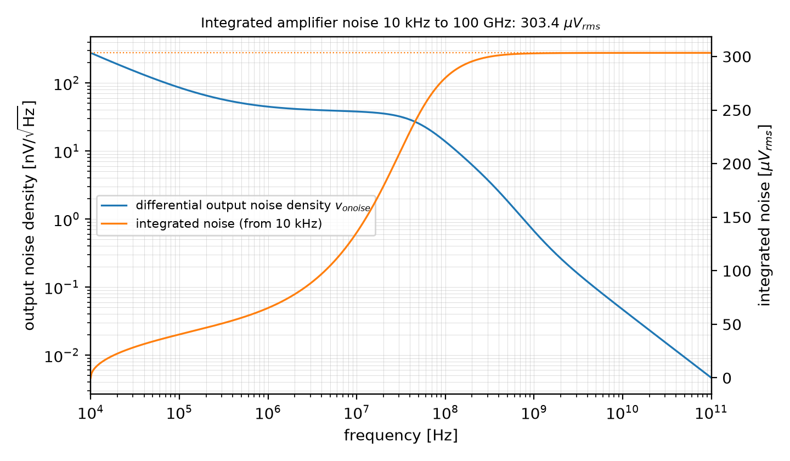
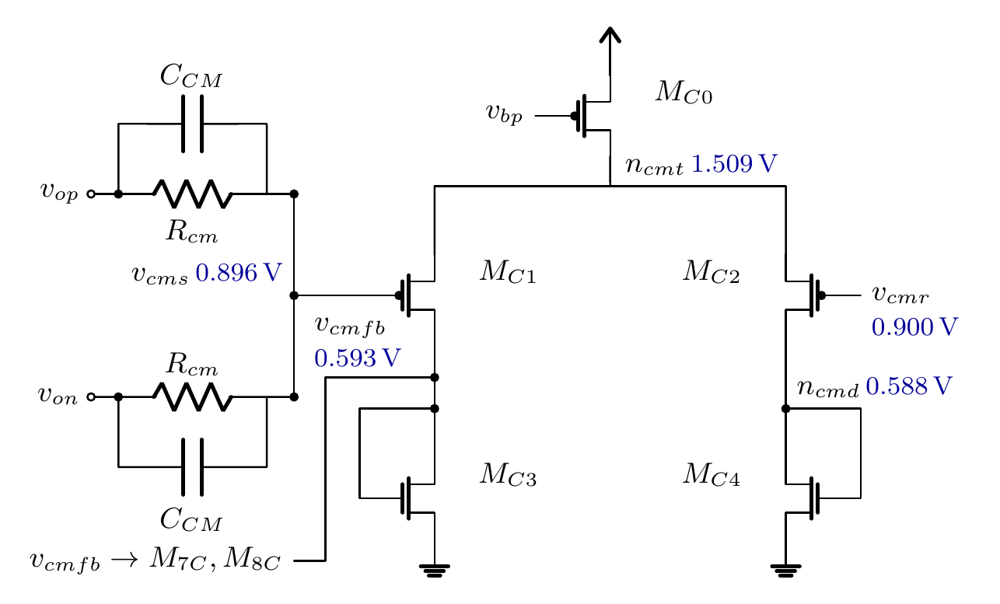
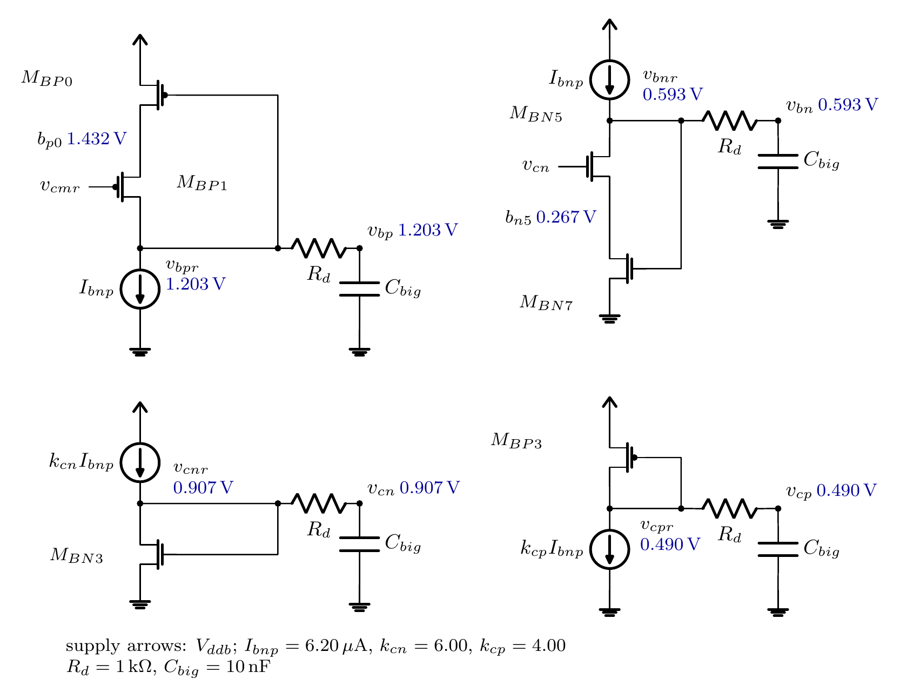
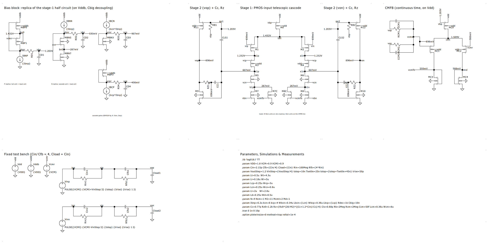

# Residue amplifier for a pipeline ADC in 0.18 µm CMOS

A fully differential switched-capacitor residue amplifier with a closed-loop gain of 4, designed
from scratch in 0.18 µm CMOS at 1.8 V and verified in LTspice. It was the design project of
EE4525 Analog CMOS Design II at TU Delft (2025-2026), where the task is to meet every
specification at the lowest possible power. The final design settles a 1.2 V differential output
step within 25 ns while drawing 0.53 mW.



The amplifier core with its simulated operating point. Stage 1 is a PMOS-input telescopic cascode
(M0 to M8), stage 2 a common-source stage on each side (M9 to M12).

## Result

All values are simulated with the BSIM3 model `log018.l` (typical corner, flicker noise
included) on the drawn schematics in `design/final/`.

| Quantity | Requirement | Simulated |
|---|---|---|
| Power, 1.8 V × average supply current over the 25 ns after the step | < 3 mW, as low as possible | 0.5295 mW (0.2942 mA) |
| Signal-to-noise ratio, amplifier noise plus kT/C | ≥ 66 dB | 66.19 dB |
| Loop settling accuracy Aβ at 25 ns | ≥ 66 dB | 72.88 dB |
| Amplifier settling accuracy A at 25 ns | > 78 dB | 87.44 dB |
| Settling time constant τ | | 2.527 ns |
| Figure of merit, −10 log₁₀(2π P τ / SNR²) | > 170 dB | 176.95 dB |
| Output step, Cin = Cload, Cfb | free | 1.2 V, 2.15 pF, 0.5375 pF |

Settling accuracy is 20 log₁₀(output step / error). Aβ takes the error at the output, A the error
at the virtual ground. The noise budget is 303.4 µVrms from the amplifier (10 kHz to 100 GHz) and
284.5 µVrms of kT/C noise, 415.9 µVrms in total. The complete results table, the operating point
and the derivations are in the 8-page report, [`report/main.pdf`](report/main.pdf).

<p>
  
  
</p>

Left: settling accuracy after the input step. The straight rise in dB is an exponential approach
with τ = 2.527 ns, and both curves are above their limits at 25 ns. Right: output noise density
and its running integral.

## How it works

Stage 1 is a telescopic cascode with a PMOS input pair. In this process model PMOS flicker noise
falls as 1/f^1.25 and NMOS flicker noise only as 1/f^0.825, so a PMOS input costs less noise at
the same current.

Stage 2 is a common-source stage. The NMOS driver takes the stage-1 output directly. The PMOS
current source receives the same signal through a 0.68 pF capacitor, while its DC gate voltage
comes from the bias line through 2 MΩ. Both devices then amplify, and a rising output is not
limited to the quiescent current. A purely class-A version of this stage needed more than 1 mW
(`design/work/classA/`).

The loop is Miller compensated with 0.77 pF and a 2.37 kΩ nulling resistor that puts the zero on
the second pole. Its unity-gain frequency is 33.75 MHz with 79.9° phase margin. The settling is
linear: a 1 % output step gives τ = 2.60 ns, close to the 2.53 ns of the full step.

The common-mode feedback is continuous time. A 2 MΩ and 50 fF network senses the output common
mode, a PMOS pair compares it with the 0.9 V reference, and a diode mirror drives one of the nine
NMOS load units on each side.

The bias block is a replica of one stage-1 half. Every amplifier transistor is an integer number
of the replica's unit devices, so the amplifier copies the replica's current density and its node
voltages follow the replica within about 1 mV. The reference current is 6.2 µA, the lowest value
at which the amplifier still settles 0.3 ns early when any one of the Miller capacitor, the
nulling resistor, the coupling capacitor or the bias current is off by 1 %.

<p>
  
  
</p>

Left: common-mode feedback. Right: replica bias.

## Running it

In plain LTspice, open `design/final/amp_tran.asc` (transient) or `design/final/amp_noise.asc`
(noise). They load `log018.l` from their own folder. That file includes its transistor sections
from `C:\Program Files\LTC\LTspiceIV\lib\cmp\log018.l`, the location the course prescribes, so
a copy has to be installed there (see [`models/README.md`](models/README.md)). The `.meas`
results appear in the SPICE error log: `A25`, `Ab25`, `P_mW` and `tau` for the transient run,
`Vn_amp`, `Vn_kTC`, `Vn_tot` and `SNR_dB` for the noise run.



The Python tooling in `tools/` runs LTspice XVII headless (under Wine on Linux) and needs
[uv](https://docs.astral.sh/uv/):

```bash
uv run tools/evaluate.py --tran design/final/amp_tran.asc --noise design/final/amp_noise.asc --tag final --publish
uv run tools/robust.py design/final/amp_tran.asc    # step polarity, 20/50/100 ps edges, two tolerances
uv run tools/crosscheck.py all                      # KCL at every node and every formula in the report
uv run tools/report.py build                        # the 8-page report
```

`evaluate.py` produces the 22-row results table and a pass or fail for each requirement.
`tools/selftest.py` checks the toolchain against a reference design that is not part of this
repository.

## Repository layout

| Path | Contents |
|---|---|
| `design/final/` | the drawn schematics, the model file and the netlist they are proven equivalent to |
| `design/work/` | netlists and test benches used during the design, the schematic generator, the class-A variant |
| `tools/` | LTspice runner, metrics, the pass or fail evaluation, robustness sweep, gm/ID sizing tables, optimiser, report macros |
| `report/` | LaTeX sources of the report, CircuiTikZ schematics, generated values and figures |
| `brief/` | the assignment, its specification in one page, clarifications and design notes |
| `PROGRESS.md` | the design log: budget, every experiment with its numbers, dead ends |
| `reference/` | the earlier EE4520 amplifier used for the figure-of-merit comparison, literature notes |
| `models/` | the original `log018.l` process model |
| `legacy-v1/`, `legacy-v2/` | two earlier designs, kept as they were |

## Earlier designs

`legacy-v1/` is a single-stage gain-boosted folded cascode from June 2026. It drew 2.04 mW and
missed the 25 ns settling requirement. `legacy-v2/` is a class-AB current-reuse amplifier that
simulated at 0.19 mW, but its time constant came from a non-exponential large-signal recovery, so
its 183 dB figure of merit was not credible. The two-stage structure here is simpler and settles
exponentially.

## Licence

The design files, tooling and report are released under the [MIT licence](LICENSE). The process
model `log018.l` and the course material in `brief/` and `reference/ee4520/pdfs/` belong to their
owners and are included for reference only.
