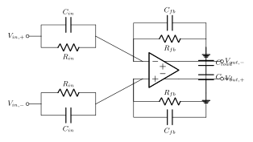

# Deliverable 1 — Table of Results (target spec)

Course: **EE4525 2025/2026 — A Residue Amplifier for a Pipeline ADC**
Due: **2026-06-28**
Process: 0.18-µm CMOS (BSIM3, 1.8 V), LTSpice

Green = hard spec from the project PDF. Achieved column to be filled during design.

| #  | Design Item                              | Unit       | Spec                | Achieved |
|----|------------------------------------------|------------|---------------------|----------|
| 1  | SNR                                      | dB         | **66**              |          |
| 2  | $A\beta_{settle}$ (loop setting)         | dB         | **66**              |          |
| 3  | $A_{settle}$ (amplifier settling)        | dB         | **> 78**            |          |
| 4  | $T_{settle}$ (to required accuracy)      | ns         | **25**              |          |
| 5  | $T_{30\,\mathrm{dB}}$                    | ns         | ---                 |          |
| 6  | $T_{38.6\,\mathrm{dB}}$                  | ns         | ---                 |          |
| 7  | $\tau = T_{38.6\,\mathrm{dB}} - T_{30\,\mathrm{dB}}$ | ns | ---            |          |
| 8  | Power dissipation (amplifiers only)      | mW         | **< 3**, low as poss|          |
| 9  | $I(V_{dd})$ (amps only, no biasing)      | mA         | < 1.7, low as poss  |          |
| 10 | Total effective $kT/C$ noise at output   | µV$_{rms}$ | free                |          |
| 11 | Total integrated amplifier noise         | µV$_{rms}$ | free                |          |
| 12 | Total integrated noise (10 kHz–100 GHz)  | µV$_{rms}$ | free                |          |
| 13 | Input step voltage                       | mV         | $V_{out}/4$         |          |
| 14 | Output step voltage                      | V          | free                |          |
| 15 | $C_{in}$                                 | pF         | ---                 |          |
| 16 | $C_{fb}$                                 | pF         | ---                 |          |
| 17 | $C_{load}$                               | pF         | **= $C_{in}$**      |          |
| 18 | $C_{CM}$                                 | pF         | ---                 |          |
| 19 | $R_{fb}$                                 | GΩ         | big                 |          |
| 20 | $C_{big}$                                | nF         | big                 |          |
| 21 | $\mathrm{FoM}_{lin} = 2\pi \cdot P \cdot \tau / \mathrm{SNR}_{lin}^2$ | J |   |          |
| 22 | $\mathrm{FoM}_{dB} = 10\log_{10}(\mathrm{FoM}_{lin})$ | dB |          |          |

## Pipeline-ADC context (from PDF)

- 12-bit pipeline ADC, 2 bits resolved per stage → residue gain $2^2 = 4$.
- Required gain accuracy (12 − 2 = 10 bits residual): $0.5 \cdot 2^{-10} \equiv -66\,\mathrm{dB}$.
- Sampling rate **20 MS/s**, 50 % duty cycle → **25 ns** for amplification phase.
- Architecture is fully-differential switched-capacitor amplifier with **real CMFB** and (optionally) **real gain-boosters**. **No ideal sources** allowed except in the bias block.

## Top-level circuit (Fig. 1 of project PDF)

## Key constraints (from PDF + faq.txt)

- BJT / JFET forbidden. Only NMOS / PMOS / R / C.
- Total non-bias capacitance $\leq 1000\,\mathrm{pF}$. $R \leq$ a few MΩ ($\leq$ GΩ only for $R_{in}$ / $R_{fb}$).
- All NMOS bulk → GND. PMOS bulk free ($V_{dd}$ or own source).
- $M$ (parallel-device count) must be integer.
- $C_{load}$ must equal $C_{in}$.
- $kT/C$ noise is hand-computed and added to LTSpice noise output before SNR.
