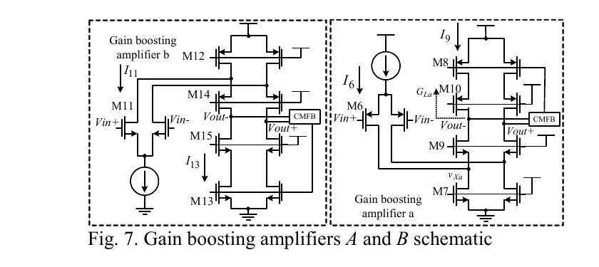

# 10 — Gain-booster design (real circuits to replace the ideal blocks)

Reference + plan for the two **real gain-boosting amplifiers** we must draw in
Phase 4 (the EE4520 `Ideal Gain-Boosting PMOS/NMOS` VCVS boxes — `E2/E3`, `E5/E6`
— are forbidden in EE4525). Template = Binkley Fig. 7; improvement = Ryu's
capacitive level shifter.

## Binkley's Fig. 7 — the real-booster template

*Figure: Yang, Binkley & Li, "Modeling and Optimization of Fast-Settling-Time
Gain-Boosted Cascode CMOS Amplifiers," IEEE SoutheastCon 2010, Fig. 7 — cropped
for study reference; see `binkley_fig7_…pdf`.*

Each booster is a **single-stage folded-cascode differential amplifier with its
own CMFB**:

| | **Amplifier A** (right) | **Amplifier B** (left) |
|---|---|---|
| Input stage | **PMOS** input pair `M6` (tail `I6` *above*) | **NMOS** input pair `M11` (tail *below*) |
| Senses / regulates | the **NMOS** cascode (low-side node `v_Xa`, `G_La`) | the **PMOS** cascode (high-side node) |
| Devices | `M6`–`M10`, bias `I6/I9` | `M11`–`M15`, bias `I11/I13` |
| CMFB | own CMFB block | own CMFB block |
| Role | **in the signal path** (booster A) | **not in signal path** (booster B) |

Why each input type: a **PMOS-input** booster sits comfortably at a **low**
common-mode (the NMOS-cascode source), an **NMOS-input** booster at a **high** CM
(the PMOS-cascode source). Both are themselves cascoded for high gain (Binkley's
case study: boosters give the main amp ~97.5 dB).

## How it maps onto our core (EE4520 numbering)

| EE4520 ideal box | Real booster (Binkley type) | Regulates | Input type |
|---|---|---|---|
| `Ideal Gain-Boost NMOS` (`E5/E6`) | **Booster A** | NMOS cascode `Mn6/Mn8` (low node) | **PMOS** input |
| `Ideal Gain-Boost PMOS` (`E2/E3`) | **Booster B** | PMOS cascode `Mp2/Mp4` (high node) | **NMOS** input |

Each replaces an ideal VCVS (`Aadd=100`) with this ~6–8-device folded-cascode amp
**plus its own CM stabilization** — see `02_topology_choice.md` build plan.

## Sizing & speed rules (Binkley, for **minimum settling**)

With $\omega_u \approx g_{m1}/C_L$ the main-amp unity GBW:

- **Booster A (in signal path):** $\mathrm{GBW}_A = 0.8\,\omega_u$, $\mathrm{PM}_A = 70°$.
- **Booster B (not in path):** $\mathrm{GBW}_B = 0.4\,\omega_u$, $\mathrm{PM}_B = 60°$.
- Keep the cascode-source pole high: $\omega_{P4} = (g_{m,cas}+g_{mb,cas})/C_{X} \gtrsim 2.6\,\omega_u$.
- **Doublets:** the boosters inject pole-zero doublets. *Low* booster PM → complex
  (ringy) doublets; *high* PM → real. The doublet slows the **high-accuracy**
  settling, so push GBW/PM into the real-doublet regime and keep the doublet
  **beyond $\omega_u$** — critical for our 0.05 % (66 dB) settle in 25 ns.

## The improvement for our power grade (Ryu)

Binkley uses **two separate** boosters, and the **PMOS-input** one (booster A) is
the costlier. **Ryu's capacitive level shifter** lets a **single cheap
NMOS-input booster regulate *both* cascodes** → less current and area. Adopt
Fig. 7's *topology*, but layer Ryu's level-shift trick to avoid paying for two
full boosters. (See `../reserach-papers/README.md`, Paper 2.)

## Constraints for *our* implementation (vs. Binkley)

- **Process / supply:** Binkley is **0.5 µm / 3.3 V**; we are **0.18 µm / 1.8 V**
  → much **tighter headroom**. Keep each booster's stack low; all boosters share
  the **single 1.8 V rail** (`07` §5.1) — no boosted supply.
- **Each booster needs CM stabilization** (its own small CMFB or a CM-stable
  pseudo-diff structure), as Fig. 7 shows.
- **Bias:** the boosters need their own bias currents/voltages → part of the
  **extended bias block** (`02` build plan).
- **Build order (Phase 4):** NMOS-cascode booster (A, PMOS-input) first with the
  other kept ideal, then the PMOS-cascode booster (B), per Binkley's advice and
  the PDF.

## Phase-4 implementation — DONE 2026-06-28 (real boosters, verified)

Both ideal VCVS boosters (`E2/E3` PMOS-side, `E5/E6` NMOS-side, `Aadd=100`) were
replaced with **real differential folded-cascode aux-amps, each with its own
reference-pinned CMFB** (Binkley Fig. 7 template). Drawn schematics + full method
in `../design/gain-boost/` (`folded_cascode_gb{,_ac,_tran}.asc`, `phase4_results.txt`).

### Real booster topology (as built)

| | **Booster A** (NMOS-cascode, in-path) | **Booster B** (PMOS-cascode, off-path) |
|---|---|---|
| Input pair | **PMOS** (sense CM $\approx0.18\,\mathrm{V}$, low) | **NMOS** (sense CM $\approx1.55\,\mathrm{V}$, high) |
| Senses | NMOS cascode sources `Vgnp/Vgnn` | PMOS cascode sources `Vgpn/Vgpp` |
| Drives | NMOS cascode gates `Vnl/Vnr` (CM = `Vcn`) | PMOS cascode gates `Vpr/Vpl` (CM = `Vcp`) |
| Fold | PMOS-in folds **down** to NMOS-cascode output | NMOS-in folds **up** to PMOS-cascode output |
| CMFB | ref-pinned diff-pair → output CM = `Vcn` | ref-pinned diff-pair → output CM = `Vcp` |
| Bias | reuses `Vbp/Vbn` (tail/source), `Vcn` (casc gate) | reuses `Vbp/Vbn`, `Vcp` (casc gate) |

A **folded** (not telescopic) booster is mandatory on 1.8 V: the sense node (cascode
source) and the drive node (cascode gate) are a full $V_{gs}\!\approx\!0.65\,\mathrm{V}$
apart, which a simple 5-T OTA cannot span (its output is tied to the input through the
tail). **CMFB must be reference-pinned** (not self-biased): a self-biased CMFB lands
the gate CM where the pull device sources the branch current; for B that landed
$V_{pr}\!=\!566\,\mathrm{mV}$ (vs $V_{cp}\!=\!873$), pulling the PMOS-cascode source down
and **ballooning the main-amp branch current** $177\!\to\!256\,\mu\mathrm{A}$ →
$I(V_{dd})\!=\!1.768\,\mathrm{mA}$ (ceiling **breach**). Pinning the gate CM to
$V_{cn}/V_{cp}$ restores the cascode sources to ~ideal and the amp to $1.66\,\mathrm{mA}$.

### Sizing (W = 1 µm, integer M; full table in `phase4_results.txt`)

Lean bias (speed-/headroom-bound, not gain-bound): each booster branch ≈ 8–11 µA, tails
17–21 µA, CMFB tail ≈ 17 µA. Tail/sink current sources `L=0.18 µm`; cascodes `L=0.30 µm`;
self/CMFB pull devices `L=0.50 µm` for higher $r_o$. **Total booster draw ≈ 111 µA**
(A ≈ 50 µA, B ≈ 60 µA).

### Achieved vs targets

| Quantity | Target | Achieved |
|---|---|---|
| **$A_0$ (genuine real-booster test)** | $\ge 78\,\mathrm{dB}$ (design ~80) | **101.3 dB** (+23 dB margin; un-boosted core = 55.8 dB → boosters add **+45.5 dB**) |
| Amp GBW $=f_u/\beta$ | $\approx 264\,\mathrm{MHz}$ | **261.9 MHz** |
| Phase margin | $\ge 60°$ | **85.9°** |
| $I(V_{dd})$ | $< 1.7\,\mathrm{mA}$ | **1.658 mA** (2.985 mW) |
| Output CM / CMFB | unregressed (0.900 V) | **0.906 V**, CM-step stable |
| All FETs (incl. 28 booster) | saturated | **yes** |
| Booster A loop gain | high | $V_{nl}/V_{gnp}=120$ (41.6 dB); holds source to ~0.02 % of swing |

### Booster UGF / doublet

Booster UGF $\approx g_{m,in}/(2\pi C_{gate})\approx 0.5\,\mathrm{GHz}$ — **faster** than the
Binkley $0.8\,\omega_u/0.4\,\omega_u$ (211 / 106 MHz) minimum-settling targets. Faster is
*conservative* here: it pushes the booster pole-zero **doublet beyond $\omega_u$** (52.9 MHz
loop crossover), so it does not create a slow settling tail. Confirmed by the clean
single-pole AC (PM 85.9°, no peaking) and a **monotone CM-step recovery** (no doublet ring);
the closed-loop transient differential output stays $\le 6\times10^{-5}\,\mathrm{mV}$ (boosters
orthogonal to CM → differentially stable). The exact $0.8\,\omega_u/70°$ tuning and the
high-accuracy ($0.05\,\%$ / 25 ns) settling closure are revisited in Phase 5.

### Status

- [x] Booster A (PMOS-input folded cascode + ref-pinned CMFB) → drawn → verified (op + AC) → in core
- [x] Booster B (NMOS-input) likewise; both real → $A_0$ 101.3 dB, $I(V_{dd})$ 1.66 mA
- [ ] Ryu capacitive-level-shift single-booster variant — *not adopted* (two real boosters fit budget; revisit only if Phase-5 power pass needs it)
- [x] Verified 1.8 V headroom (all sat.), doublet beyond $\omega_u$; exact $0.8\omega_u$/70° & $0.4\omega_u$/60° tuning deferred to Phase-5 settling closure

Cross-refs: `02_topology_choice.md` (build plan), `06_settling_analysis.md`
(doublets/settling), `08_power_prediction.md` (NEF/power), `05_cmfb_design.md`
(CMFB style), `../reserach-papers/README.md` (Binkley + Ryu).
